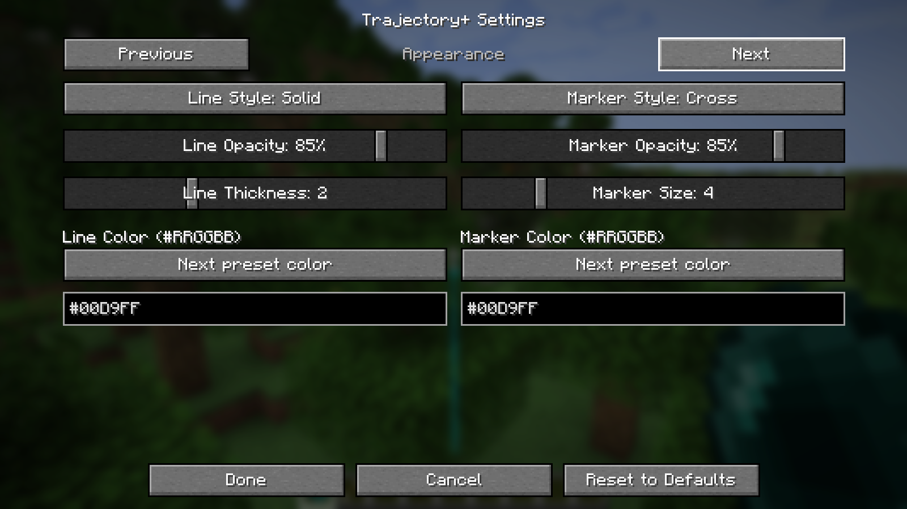
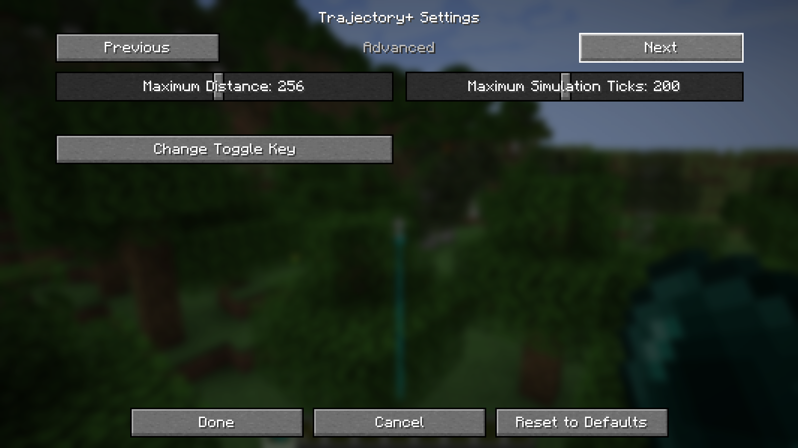

# Trajectory+

A client-side Fabric mod for Minecraft Java Edition that previews curved projectile paths and marks predicted block impacts.

## Screenshots

Captured in Minecraft Java Edition 1.21.1 with Fabric and Trajectory+ 1.0.0.

### Projectile previews

| Ender pearl trajectory | Splash potion trajectory |
| --- | --- |
|  |  |

| Dashed line and square marker | Dotted line and circular marker |
| --- | --- |
|  |  |

### Settings

| General | Projectiles |
| --- | --- |
|  |  |

| Appearance | Advanced |
| --- | --- |
|  |  |

## Features

- Separate launch profiles for ender pearls, bows, loaded crossbows with arrows, snowballs, eggs, tridents, splash and lingering potions, and experience bottles.
- Simulation at 20 ticks per second, using per-projectile initial speed, drag and gravity, water drag approximation, inherited player motion and actual voxel-shape block raycasts.
- Curved, connected world-space trajectory (solid, dashed or dotted) and cross, square or circular impact marker.
- **Bow aiming shows only the predicted impact marker** (no trajectory line obstructing the view).
- Adjustable visibility, line/marker colors in `#RRGGBB` format, opacity, approximate line thickness, marker size, per-projectile toggles and distance/tick budgets.
- Native Minecraft-style configuration accessible from **Mod Menu → Trajectory+ → Configure**, using only vanilla widgets.
- Includes the user-provided bow-and-crosshair icon in Fabric's mod list.
- **Done** applies and saves; **Cancel/Escape** discards changes; **Reset to Defaults** resets staged values.
- Default **P** key toggles the entire preview. Change it via the **Change Toggle Key** button, which opens Minecraft's controls screen.
- English and Dutch language keys, local JSON config at `config/trajectoryplus.json` (a sample is included).
- No server requirement, networking, telemetry, particles, forced chunk loads, automatic aiming or changes to gameplay physics.

## Install and build

Choose the JAR for your exact Minecraft version. The
[installation guide](MODRINTH_DESCRIPTION.md#installation) covers Fabric Loader,
Fabric API, Mod Menu, and the required Java version. The
[build guide](BUILD_JAR_GITHUB.md) covers GitHub Actions artifacts and local builds.

## Source code overview

- `src/main` contains prediction physics, line and impact-marker geometry, configuration, translations, and the Mod Menu entrypoint.
- `src/yarn` and the version-specific Yarn source sets connect the shared code to Minecraft 1.21.x.
- `src/mojang` and the version-specific Mojang source sets connect the shared code to Minecraft 26.x and its gizmo pipeline.

## Important accuracy limitations

- **Not a guaranteed landing indicator.** Vanilla projectile spread/randomness, server latency, motion changes, server changes and collision with *moving entities* can invalidate predictions.
- Projectile launch origins and drag/gravity coefficients are approximations.
- The simulator uses one movement segment per game tick and handles block raycasting, not full projectile-entity hitbox collision or server-side special effects.
- Ender pearl impact is **not** a guarantee of final teleport position.
- Crossbows loaded with rockets, multi-projectile spread and nonstandard ammunition are not fully modeled; fireworks are intentionally skipped.
- Dashes/dots are split inside each simulated tick segment; spacing may not be perfectly uniform across boundaries.
- Through Minecraft 1.21.10, thickness uses slightly offset line segments. Later builds use the renderer’s line-width parameter.
- Circle and square markers are drawn in a horizontal plane; on vertical surfaces they are less legible than the cross.
- In-game FPS and performance have yet to be measured.
- Multiplayer servers may restrict visual prediction mods. Respect server rules.

## Testing

[TEST_REPORT.md](TEST_REPORT.md) tracks compilation, packaged client startup,
and gameplay checks. To run the numerical physics checks without Minecraft
dependencies, use `bash offline-test.sh` with a Java 21 or newer JDK.

## License

MIT; see `LICENSE`.
