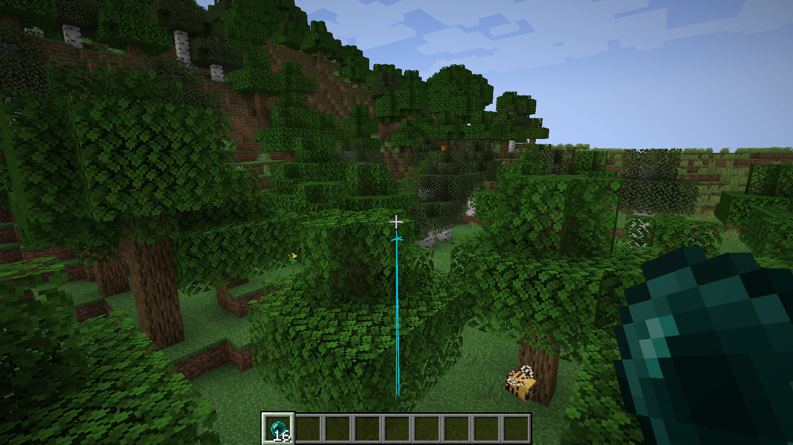
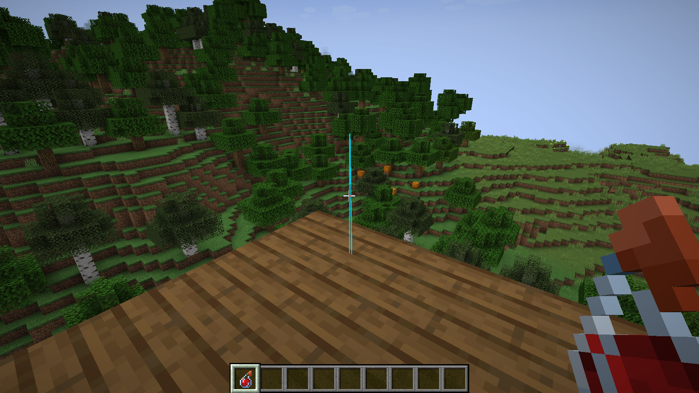
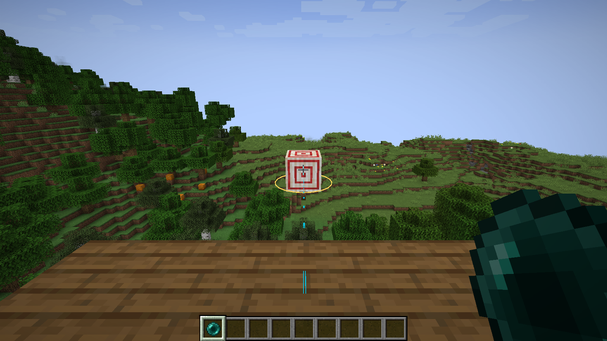
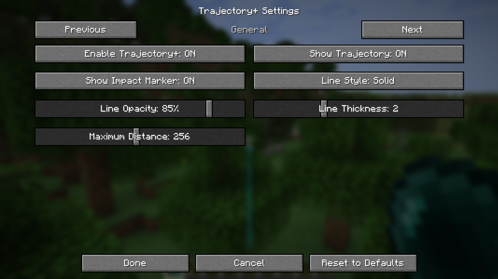
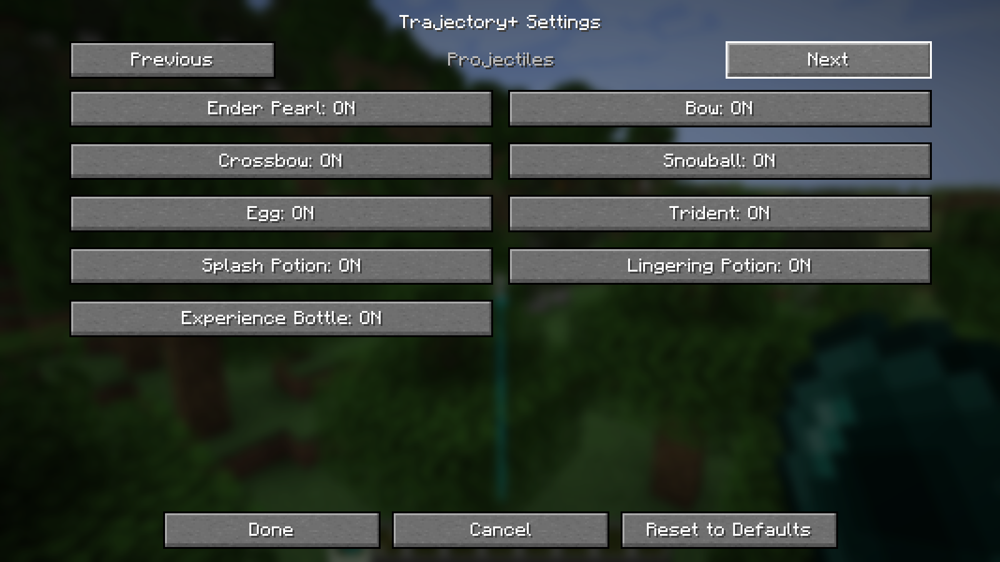

# Trajectory+

A **Minecraft Java Edition 1.21.1 / Fabric** client-only mod project that previews curved projectile paths in 3D and marks predicted block impacts. Version `1.0.0` (development candidate; **not a verified release**).

## Screenshots

Captured in Minecraft Java Edition 1.21.1 with Fabric and Trajectory+ 1.0.0.

### Projectile previews

| Ender pearl trajectory | Splash potion trajectory |
| --- | --- |
|  |  |

| Dashed line and square marker | Dotted line and circular marker |
| --- | --- |
|  |  |

### Settings

| General | Projectiles |
| --- | --- |
|  |  |

| Appearance | Advanced |
| --- | --- |
|  |  |

## Features represented in the source

- Separate launch profiles for ender pearls, bows, loaded crossbows with arrows, snowballs, eggs, tridents, splash and lingering potions, and experience bottles.
- Simulation at 20 ticks per second, using per-projectile initial speed, drag and gravity, water drag approximation, inherited player motion and actual voxel-shape block raycasts.
- Curved, connected world-space trajectory (solid, dashed or dotted) and cross, square or circular impact marker.
- **Bow aiming shows only the predicted impact marker** (no trajectory line obstructing the view).
- Adjustable visibility, line/marker colors in `#RRGGBB` format, opacity, approximate line thickness, marker size, per-projectile toggles and distance/tick budgets.
- Native Minecraft-style configuration accessible from **Mod Menu → Trajectory+ → Configure**, using only vanilla widgets.
- Includes the user-provided bow-and-crosshair icon in Fabric's mod list.
- **Done** applies and saves; **Cancel/Escape** discards changes; **Reset to Defaults** resets staged values.
- Default **P** key toggles the entire preview. Change it via the **Change Toggle Key** button, which opens Minecraft's controls screen.
- English and Dutch language keys, local JSON config at `config/trajectoryplus.json` (a sample is included).
- No server requirement, networking, telemetry, particles, forced chunk loads, automatic aiming or changes to gameplay physics.

## How to build on Windows 11 Home

**Requirements:** Minecraft Java development environment, internet access for dependencies, **JDK 21** installed and available in `PATH` / `JAVA_HOME`.

1. Unzip the `TrajectoryPlus` project to a normal folder.
2. Open PowerShell in that folder.
3. Run `java -version` and verify it reports Java 21.
4. Run `./gradlew.bat build` (or `./gradlew.bat runClient` for the test client).
5. If compilation succeeds, find the **remapped** mod JAR in `build/libs/trajectoryplus-1.0.0.jar` (not the `-sources` / `-dev` JAR).

The provided `gradlew.bat` and `gradlew` are **self-contained Gradle 8.12 bootstrap launchers**, not the official Gradle Wrapper distribution. They download Gradle from `services.gradle.org` on first use and store it in `.gradle-bootstrap/`. They then invoke Gradle with the project build. The normal Gradle dependency repositories fetch Minecraft, Fabric, Mod Menu and their required libraries.

For a standard Gradle Wrapper (after a successful Gradle setup), run `./gradlew.bat wrapper --gradle-version 8.12`; this creates the usual wrapper scripts and `gradle-wrapper.jar`.

## Install in Minecraft

1. Install a compatible Minecraft **1.21.1 Fabric** profile.
2. Install Fabric API `0.116.7+1.21.1` and Mod Menu `11.0.4` or another compatible 11.x build.
3. Place the *verified compiled* `trajectoryplus-1.0.0.jar` in `.minecraft/mods/`.
4. Launch the Fabric profile and use Mod Menu to configure the mod. Default preview toggle is **P**.

**Do not install the source ZIP as a mod.** A genuine compiled JAR is required. This submission includes no validated compiled JAR.

## Source code overview

- `TrajectoryPlusClient.java`: registered client tick, keybinding and world render events.
- `prediction/ProjectileResolver.java`: detects projectiles, bow draw amount, crossbow charge, initial velocity and spawn point.
- `prediction/ProjectileProfile.java`: parameters for the nine supported projectile categories.
- `prediction/TrajectoryPredictor.java`: discrete tick simulation and stop conditions.
- `prediction/CollisionResolver.java`: vanilla voxel-shape block collision raycast.
- `rendering/TrajectoryRenderer.java`: camera-relative line rendering; styles and approximated thickness.
- `rendering/ImpactMarkerRenderer.java`: marker geometry centered on the returned hit coordinate.
- `config/`: JSON loading, validation, atomic best-effort save, defaults.
- `gui/TrajectorySettingsScreen.java`: native widgets, four pages, staged settings.
- `integration/TrajectoryModMenu.java`: Mod Menu API entrypoint.

## Important accuracy limitations

- **Not a guaranteed landing indicator.** Vanilla projectile spread/randomness, server latency, motion changes, server changes and collision with *moving entities* can invalidate predictions.
- Uses approximate projectile launch origins and drag/gravity coefficients. Exact gameplay parity still requires testing in MC 1.21.1.
- The simulator uses one movement segment per game tick and handles block raycasting, not full projectile-entity hitbox collision or server-side special effects.
- Ender pearl impact is **not** a guarantee of final teleport position.
- Crossbows loaded with rockets, multi-projectile spread and nonstandard ammunition are not fully modeled; fireworks are intentionally skipped.
- Dashes/dots are split inside each simulated tick segment; spacing may not be perfectly uniform across boundaries.
- Thickness is approximated by multiple camera-relative line segments. It is not a true independent pixel-width render layer.
- Circle and square markers are drawn in a horizontal plane; on vertical surfaces they are less legible than the cross.
- In-game FPS and performance have yet to be measured.
- Multiplayer servers may restrict visual prediction mods. Respect server rules.

## Testing

The supplied 1.0.0 JAR was functionally tested in a local creative world on Minecraft 1.21.1 with Fabric. The checks covered previews for all nine projectile types, the four settings pages, and saving, cancelling, resetting, and changing the toggle key. Exact projectile parity and multiplayer compatibility remain unverified.

For a quick zero-dependency numerical helper test on Linux/macOS:

```bash
./offline-test.sh
```

Or on Windows PowerShell:

```powershell
mkdir build/offline-test
javac -d build/offline-test src/main/java/com/trajectoryplus/prediction/PhysicsMath.java src/test/java/com/trajectoryplus/PhysicsMathSelfTest.java
java -cp build/offline-test com.trajectoryplus.PhysicsMathSelfTest
```

This does **not** replace a Gradle build, Minecraft client launch, rendering check or in-game hit comparison. See `TEST_REPORT.md` and `BUILD_REPORT.md`.

## Modrinth publication

This repository is a development candidate, **not an eligible, tested Modrinth release**. Before publication, build and play-test it, fix discrepancies, review current Modrinth Content Rules and AI-assistance disclosure/eligibility, and add original project-owner contributions. No automatic publication is performed.

## License

MIT; see `LICENSE`.
